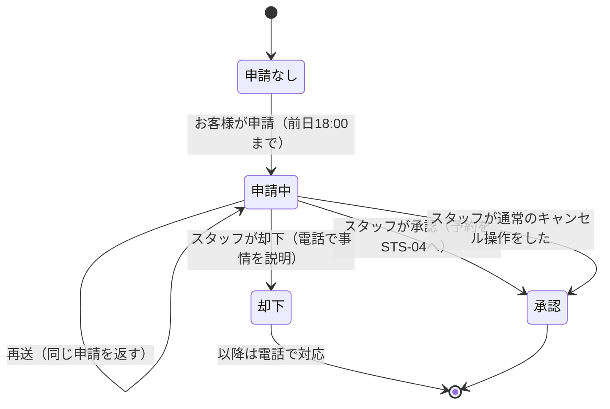

# 顧客からのキャンセル申請（Issue #97）

お客様がWebからキャンセルを「申請」し、店舗が確認して「成立」させる仕組みの仕様です。

## 方針

- **申請と成立を分ける。** お客様の操作だけではキャンセルは成立しません。申請中も予約ステータスは変わらず、スタッフが承認した時点で `STS-04`（キャンセル）になります。
  - 理由：オンライン決済がなく、確定もスタッフが手で行う運用のため。即時キャンセルにすると、キャンセル料の扱いや天候中止（店都合・無料）との区別をスタッフが後から確認できなくなります。
  - 参考：海外の予約サービス（Bókunなど）は決済と連動した即時キャンセルですが、決済がない場合は申請→承認の形（Rock Gym Proなど）が一般的です。
- **店舗への通知は「アプリ内の記録」を正とする。** 申請はまず予約データに保存し、ダッシュボードと予約管理に表示します。メール・LINEでの通知は今後の補助手段で、送れなくても申請は失われません。
- **当日・直前は電話。** オンライン申請は「ダイブ日の前日18:00（日本時間）」まで。それ以降は画面に電話での連絡を案内します。船の出航準備に関わるため、直前は確実に話せる手段を優先します。

> 締切時刻・キャンセル料の文言は店舗運用の確認後に調整してください（`src/lib/cancellationRequest.ts` の `CANCELLATION_REQUEST_CUTOFF_HOUR_JST`）。

## 本人確認

- 予約番号と予約確認コード（予約完了画面・チェックインQR画面で案内しているもの）の両方を照合します。確認コードは推測困難なトークンで、比較は定数時間で行います。
- 予約番号・確認コードのどちらかが違う場合は、理由を区別しない同じエラーを返します（予約の有無を推測させないため）。
- 確認コードがない古い予約・電話予約は、Webからは申請できません。電話・LINEでスタッフが対応します。

## 状態

予約データに次の項目を追加します。

| 項目 | 内容 |
|---|---|
| `cancellationRequestStatus` | `pending`（申請中）／`approved`（承認＝成立）／`rejected`（却下） |
| `cancellationRequestedAt` | 申請日時 |
| `cancellationRequestNote` | お客様が入力した理由（任意・200文字まで） |
| `cancellationRequestResolvedAt` | 承認または却下した日時 |

## 申請できる条件

| 状況 | 結果 |
|---|---|
| 受付・確認中・確定の予約で、締切前、申請なし | 申請中として保存 |
| すでに申請中 | 同じ申請を返す（重複して作らない） |
| 却下済み | 申請不可。電話を案内 |
| キャンセル済み・実施済み・返金済み | 申請不可 |
| 締切（前日18:00）を過ぎた | 申請不可。電話を案内 |
| 予約番号・確認コードが一致しない | 申請不可（理由を区別しないエラー） |

## 問診URL・受付への反映

| 時点 | 問診票URL | 受付QR・チェックイン |
|---|---|---|
| 申請中 | 有効のまま（取り下げ・日程変更があり得るため） | 受付可能。スタッフの受付画面に「キャンセル申請中」を表示 |
| 承認（成立） | 既存の仕組みで無効（`isQuestionnaireReservationAllowed`） | 既存の仕組みで受付不可 |
| 却下 | 有効のまま | 通常どおり |

## 画面とAPI

- お客様：`/line-menu/cancel`（ログイン不要）。予約完了画面とチェックインQR画面からリンクします。リンクには予約番号と確認コードが入ります。
- 公開API：`POST /api/public/cancellation-requests`
  - `{ action: 'status', reservationId, reservationToken }` … 予約の概要と申請状況を返す
  - `{ action: 'request', reservationId, reservationToken, note? }` … 申請する
- スタッフ：
  - ダッシュボードに「キャンセル申請（N件）」を表示
  - 予約管理に「キャンセル申請」の絞り込み、各予約に「申請を承認してキャンセル」「申請を却下」ボタン
  - 承認は既存の `PATCH /api/reservations`（`status: STS-04`）を使います。申請中の予約なら `approved` と処理日時も記録します
  - 却下は `PATCH /api/reservations` に `cancellationRequestStatus: 'rejected'` を送ります（申請中のときだけ受け付けます）

## 通知の失敗・重複・無効な申請

- **通知の失敗**：申請は予約データに保存した時点で受付完了です。お客様には「受け付けました（まだキャンセルは成立していません）」と表示します。保存に失敗した場合は、成立も受付もしていないことを伝え、再試行か電話を案内します。
- **重複申請**：同じ予約の申請中は新しく作らず、既存の申請を返します。保存時は更新日時で競合を検知し、同時に送られても1件にまとまります。
- **無効な申請**：上の「申請できる条件」の表どおり。

## 導入時の作業

- PostgreSQL：`db/migrations/010_reservation_cancellation_requests.sql` を既存の手順（`npm run db:migrate`）で適用します。
- Google Sheets：予約シートに列が4つ増えます。シート初期化（`/api/setup`、開発環境で `ENABLE_SHEETS_SETUP=true`）を実行して列を追加してください。追加前に申請すると保存エラーになります。
- JSON（モック）：作業は不要です。

## 今後の課題

- 店舗へのメール・LINE通知（どの端末・手段で受け取るか店舗に確認してから）
- お客様への承認・却下の自動連絡
- キャンセル料の表示（規約の確定後。消費者契約法9条の「平均的な損害」を超えない設定にする）

## 検証

`npm test` の `cancellationRequest.test.ts`（判定ロジック）と `publicCancellationRequest.test.ts`（公開API）、`reservationCancellation.test.ts`（承認・却下）で確認します。
